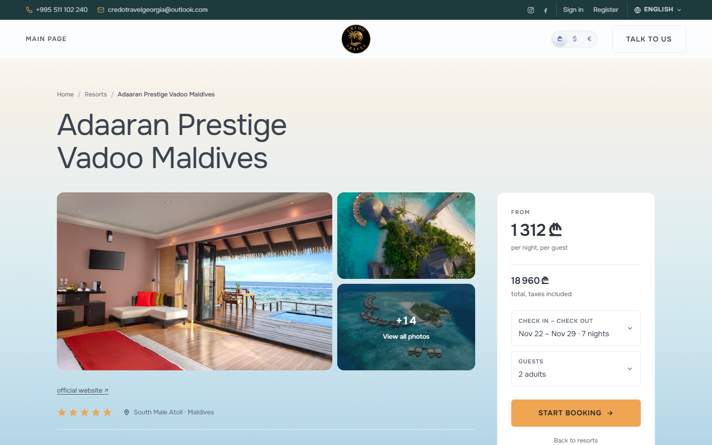
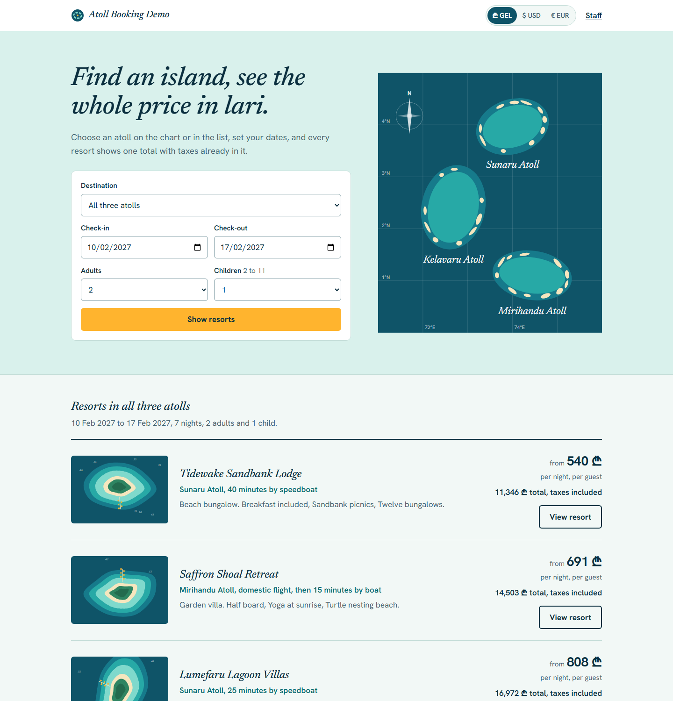
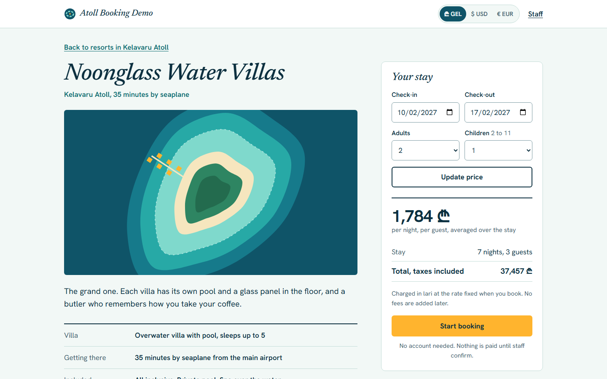

# Credo Travel

Booking website for Credo Travel, a Georgian agency selling trips to the Maldives.

**Live site:** https://www.credomaldive.com/en


I built the original project from scratch at [AllOne](https://github.com/allonelabs). Its source code belongs to the client and is private. This repository describes that project and holds a separate demo, written for this portfolio, of two of the flows I built.

## The original project

### What it does

- **Resort search.** Visitors pick a destination, dates and guests, and browse resorts with photos, location and prices.
- **Live prices.** Availability and prices come from the supplier's feed, are converted from US dollars to Georgian lari at quote time, and can be shown in lari, dollars or euros.
- **Booking without an account.** A customer books a stay in a few steps; staff confirm it and set the deposit.
- **Three languages.** Georgian, English and Russian, each on its own address (`/ka`, `/en`, `/ru`). A missing translation fails the build instead of showing an empty card.
- **Staff panel.** An order book with search and filters, a detail page per booking with its audit trail, a markup calculator, and staff roles.



### How it is built

| Part | Technology |
|---|---|
| App | Next.js 16 (App Router), React 19, TypeScript |
| Styling | Plain CSS |
| Data and sign-in | Supabase (Postgres with row-level security) |
| Hosting | Vercel |

### Things I had to get right

- Prices from the supplier arrive in dollars. Converting, adding the agency's margin and rounding without overcharging took several passes.
- Database views were running with their owner's rights, which bypassed row-level security. I found and fixed that, along with a path that let a customer confirm their own booking.
- The site only shows resorts and figures that exist in the supplier's data; every invented placeholder was removed.

`project.ts` is a short typed summary of the original project.

## Portfolio demo in this repository

The code in this repository is **not the production code**. It is a fresh re-creation written for this portfolio, with its own design, invented resorts and prices, and a mocked back end. It uses no code, text, images or data from the real site. Inside the app it is called "Atoll Booking Demo".



### What it demonstrates

- **Search and resort list.** Pick one of three invented atolls (on a drawn chart or in a list), dates, adults and children. Six fictional resorts are listed with a per-night price and a total.
- **Resort page.** Details, date and guest pickers, the price per night per guest, the total with taxes, and a currency switch between lari, dollars and euros.
- **Booking without an account.** Four steps: check the stay, enter guest details, review, confirmation with a booking reference. The form is validated in the browser and again on the server. The server recomputes the price from a fresh quote and ignores any price the browser sends.
- **Staff order book** at `/staff`. A table of bookings with search and a status filter, and a detail page where staff confirm a booking, set the deposit and see how the price was built and every status change. There is no real sign-in: an "Enter as staff (demo)" button sets a cookie.



More screenshots are in `demo-screenshots/`.

### The pricing rule

The pricing module is `lib/pricing.ts`. It is a set of pure functions over whole numbers (cents, tetri and rates in ten-thousandths), so nothing depends on floating point.

1. The mocked supplier quotes the stay in US dollars, taxes included.
2. The agency margin is added as a percentage (12% by default).
3. The result is converted to lari at the rate captured when the quote is made.
4. The exact figure is rounded **down** to a whole lari. That is the price.

The margin and the conversion are carried exactly and the figure is rounded once, at the end, downwards. The customer therefore never pays more than supplier price × (1 + margin) × rate, and the agency gives up less than one lari per booking.

Worked example: a supplier quote of $12,318.18 plus 12% is $13,796.3616; at 2.7150 lari to the dollar that is 37,457.1217 lari; the customer pays 37,457 ₾.

Dollar and euro figures are not separate prices. They are the lari total converted back at the same rate table and rounded down to the cent, so the three currencies cannot disagree and no displayed figure is worth more than the lari amount charged. The "per night, per guest" figure is the total divided by nights and guests, rounded to the nearest whole unit; it is a guide for comparing resorts, and the total is what is charged.

### What is mocked

- The supplier is a module (`lib/supplier.ts`) with six invented resorts, seasonal rates, a child rate, a tax and a per-guest levy.
- Exchange rates are a fixed sample table in `lib/quote.ts`.
- Bookings are kept in memory (`lib/store.ts`) and are lost when the server restarts. A few sample bookings are created at start-up.
- Nothing is charged and no email is sent. There is no database, no external service and no API key.
- The two typefaces (Newsreader and Hanken Grotesk) are fetched from Google Fonts by Next.js when the app is built or first run in development, then served locally. The running app makes no outside requests.

### Run it locally

Requires Node.js 22.18 or newer (the tests run TypeScript files directly with Node's built-in test runner).

```
npm install
npm run dev
```

Then open http://localhost:4820.

| Command | What it does |
|---|---|
| `npm run dev` | Development server on port 4820 |
| `npm test` | Unit tests for pricing, the supplier quote and validation |
| `npm run typecheck` | TypeScript check |
| `npm run build` | Production build |
| `npm start` | Serve the production build on port 4820 |

The agency margin can be changed with the `AGENCY_MARGIN_BPS` environment variable, in basis points (1200 = 12%).

### Where things are

| Path | Contents |
|---|---|
| `lib/pricing.ts` | Margin, conversion, rounding, currency display, formatting |
| `lib/supplier.ts` | Mocked supplier: resorts and dollar quotes |
| `lib/quote.ts` | Supplier quote to customer price, used by pages and the booking endpoint |
| `lib/validation.ts` | Stay and guest validation shared by browser and server |
| `lib/store.ts` | In-memory bookings, status changes and audit trail |
| `app/` | Pages and route handlers (Next.js App Router) |
| `components/` | Booking steps, staff actions, the atoll chart and island drawings |
| `tests/` | Unit tests |
